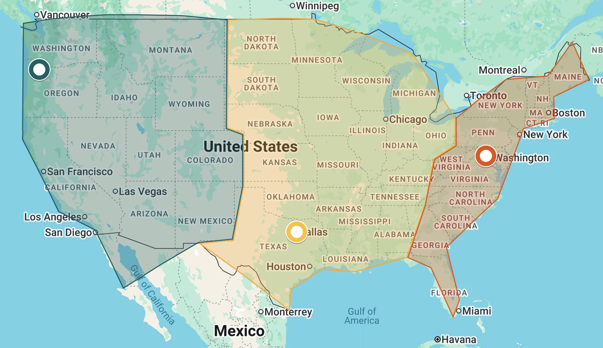

# Расчетно-пояснительная записка: VK Education High-load

## 1. Тема и целевая аудитория

[Ticketmaster](https://www.ticketmaster.com/) — крупнейший сервис продажи билетов в Северной Америке и один из крупнейших во всем мире.[^em-dash]

[^em-dash]: Здесь и далее, все тире ставил человек.

### Ключевой функционал

* Регистрация и авторизация.
* Добавление событий организатором.
* Покупка билета на событие.
* Просмотр предстоящих событий.
* Лента рекомендации событий.
* Поиск событий.
* Просмотр информации и отзывов о конкретном событии.
* Добавление отзывов о событии.

### Целевая аудитория

Родительская компания Ticketmaster — Live Nation Entertainment — не публикует свои метрики. Однако можно оценить масштаб аудитории по ежегодному отчету[^10k-filing], который она обязана публиковать как крупная американская компания: За 2025 год было продано 646 миллионов билетов среди 805 миллионов пользователей в 55 странах.

[^10k-filing]: Т.н. [Form 10-k от LIVE NATION ENTERTAINMENT, INC.](https://investors.livenationentertainment.com/sec-filings/annual-reports/content/0001335258-26-000009/0001335258-26-000009.pdf) за 2025.

Мобильное приложение Ticketmaster имеет более 30 миллионов ежемесячных пользователей.[^mobile-30mil] Сайты веб-аналитики в среднем дают оценку[^mau-web] в 95–100 миллионов запросов в месяц и около 3,5 страницы на пользователя (т.е., почти 30 миллионов пользователей) для домена [ticketmaster.com](https://ticketmaster.com), которым в основном пользуются жители Северной Америки (>80% посетителей из США) — в то время как сервис также доступен через [ticketmaster.co.uk](https://ticketmaster.co.uk) в Великобритании (4,5 млн пользователей в месяц), [ticketmaster.de](https://ticketmaster.de) в Германии (~1 млн), и т.д.

[^mobile-30mil]: [Официальный сайт](https://business.ticketmaster.com/ticketing-straight-to-your-app/) Ticketmaster Business.
[^mau-web]: [Similarweb](https://www.similarweb.com/website/ticketmaster.com/#traffic) и [Semrush](https://www.semrush.com/website/ticketmaster.com/overview/).

Также представляет интерес пиковая нагрузка. Например, в исторический пик 15 ноября 2022 года сервис получил более 3,5 миллиарда запросов (т.е. более 40&nbsp;000 в секунду) при продаже двух миллионов билетов за один день после открытия регистрации на концерт певицы Тейлор Свифт.[^eras-tour]

[^eras-tour]: Официальный сайт Ticketmaster Business: [Taylor Swift | The Eras Tour Onsale Explained](https://business.ticketmaster.com/press-release/taylor-swift-the-eras-tour-onsale-explained/).

<!-- Mentioning Taylor Swift in a report... What am I doing with my life? -->

## 2. Расчет нагрузки

### Продуктовые метрики

Возьмем за финальное значение MAU 60 млн в Северной Америке. У e-commerce относительно низкий процент конверсии MAU в DAU — приблизительно 10%. Однако у сервисов по покупке билетов еще ниже — ведь на них заходят не по привычке, а по нужде. При цифре в 8%, выходит ~4.8 млн.

Мы можем получить похожую цифру и иначе. Всего за 2025 год на Ticketmaster было продано 646 млн билетов за 2025 год, и это был первый год, в который продажи в Северной Америке были чуть меньше продаж в других частях мира. Тогда мы можем сказать, что в день нашей аудитории было продано $646000000 \cdot 45$% $\sim 290$ млн билетов в год, или примерно 800&nbsp;000 в день. Тогда при среднем значении в 2.3 билета на заказ (т.к. большинство заказов на два билета) и той-же цифре конверсии 7–8% из посетителя в покупателя, мы тоже получаем значение в 4.3–4.9 млн.

| Метрика       | Значение    |
| ------------- | ----------- |
| MAU           | >60 млн     |
| DAU           | ~5 млн      |

Если разбивать по действиям, то адекватными показались эти:

| Действие                          | На DAU/день | Всего в день |
| --------------------------------- | ----------- | ------------ |
| Вход                              | 1.2         | 6,0 млн      |
| Просмотр рекомендаций/предстоящих | 1.5         | 7,5 млн      |
| Поисковый запрос                  | 2.5         | 12,5 млн     |
| Просмотр информации о событии     | 5.0         | 25 млн       |
| Просмотр свободных мест/билетов   | 1.0         | 5 млн        |
| Попытка купить билет              | 0.07        | 350 тыс.     |
| Создание отзыва                   | 0.01        | 50 тыс.      |
| Регистрация                       | 0.003       | 15 тыс.      |

Как можно заметить, имеется очень асимметричное соотношение $11.2:0.008 \sim 140:1$ чтений к записям.

### Технические метрики

#### Данные

| Тип данных              | Расчет                                                         | Примерный размер | Рост             |
|-------------------------|----------------------------------------------------------------|------------------|------------------|
| Пользователи            | ~10 КБ на пользователя при 60 млн всего                        | ~570 GB          | Незначительный   |
| Метаданные событий      | ~100 КБ на событие при ~1 млн всего                            | ~100 GB          | Незначительный   |
| Данные сидячих событий  | ~1 КБ на ~10 тыс. сидений при ~100 тыс. сидячих событиях       | ~950 GB          | С событиями      |
| Билеты                  | ~2 КБ на билет при 646 млн. билетов в год и хранением на 7 лет | ~8.4 ТБ          | 1.2 TB/год       |
| Отзывы                  | ~5 КБ на отзыв при ~50 млн в год и хранением на 7 лет          | ~1.6 TB          | ~240 GB/год      |
| Медиа файлы событий     | 10 МБ на файл при 5 изображениях в ~1 млн событий              | ~48 TB           | С событиями      |
| Индекс поиска           | ~50% от метаданных событий                                     | ~50 GB           | С событиями      |
| Сессии, места в очереди | —                                                              | >256 GB          | Временное        |
| Логи                    | 250 млн запросов/день при ~1 KB на запрос                      | ~240 GB/день     | Несколько TB/год |

Были выбраны довольно высокие значения относительно среднего.

#### Запросы

Всего у нас приблизительно 56 млн запросов в день. Если считать, что среднее действие пользователя в конечном итоге превращается в чуть более 4–5 API запросов, получаем приблизительно 225 млн запросов в день. Это дает нам ~2600 RPS и, при соотношении 3.5–4x пика к среднему значению за день, пик в 10&nbsp;000 RPS.

| Метрика              | Значение    |
| -------------------- | ----------- |
| RPS                  | 2600        |
| RPS (пик в день)     | 10&nbsp;000 |

Если разбить по действиям, то получится примерно так:

| Запросы (~4x к самим действиям)   | Всего в день | RPS   | Размер ответа  |
| --------------------------------- | ------------ | ----- | -------------- |
| Вход                              | 24,0 млн     | 277   | 30 КБ          |
| Просмотр рекомендаций/предстоящих | 30 млн       | 350   | 100 КБ         |
| Поисковый запрос                  | 50 млн       | 580   | 100 КБ         |
| Просмотр информации о событии     | 100 млн      | 1160  | 200 КБ         |
| Просмотр свободных мест/билетов   | 20 млн       | 230   | 30 КБ          |
| Попытка купить билет              | 1.4 млн      | 16    | 30 КБ          |
| Создание отзыва                   | 200 тыс.     | 2.5   | 60 КБ          |
| Регистрация                       | 60 тыс.      | 1     | 60 КБ          |

Взвешенное среднее размера запроса: 130 КБ. Тогда на API приходится в среднем ~2.7 Gbit/s сетевого трафика, максимальный поток в 10.5 Gbit/s, и ежесуточный объем данных в ~29.4 ТБ.

Помимо API, страницы работают с медиа файлами. Будем считать, что мы отдаем оптимизированные версии — 300 КБ на большие изображения и 30 КБ на маленькие вместо оригинальных 10 МБ:

| Действие                          | Всего в день | Расчет                  | Размер | Объем в день |
| --------------------------------- | ------------ | ----------------------- | ------ | ------------ |
| Просмотр информации о событии     | 25 млн       | 5 файлов весом в 300 КБ | 1.5 МБ | ~37.5 ТБ     |
| Просмотр рекомендаций/предстоящих | 7,5 млн      | 20 файлов весом в 30 КБ | 600 КБ | ~4.5 ТБ      |
| Поисковый запрос                  | 12,5 млн     | 20 файлов весом в 30 КБ | 600 КБ | ~7.5 ТБ      |

Тогда медиа добавляет с среднем ~4.7 Gbit/s, максимальный поток в ~18 Gbit/s, и ежесуточный объем данных в 50 ТБ.

| Трафик  | В сутки   | Среднее     | Пик          |
| ------- | --------- | ----------- | ------------ |
| API     | ~29.4 ТБ  | ~2.7 Gbit/s | ~10.5 Gbit/s |
| Медиа   | ~50 ТБ    | ~4.6 Gbit/s | ~18 Gbit/s   |
| Всего   | ~80 ТБ    | ~7.3 Gbit/s | ~28 Gbit/s   |

## 3. Глобальная балансировка нагрузки

### Разбиение функционала

Функционал разбивается на две больших категории:

1. Просмотр доступных мест, покупка билетов, и "комната ожидания" для очереди покупки.
2. Поиск, рекомендации, отзывы, и остальной функционал.

На вторую категорию приходится ~95% запросов. Это почти полностью кэшируемые запросы на чтение. Здесь допустимо отставание данных от актуальных на несколько секунд или даже минут, поэтому эти данные могут быть дублированы между всеми датацентрами.

Первая получает менее 250 запросов в секунду, но для этих запросов необходима высокая точность и актуальность. Билет на одно и то же место не должен быть продан двум людям. Этой категории функционала требуется один авторитативный сервер для каждого события. Для этого стоит использовать датацентр, физически самый близкий к месту проведения.

Медиа запросы обслуживаются через CDN и при доле попаданий в кэш ~95%[^cf-cache-hit] редко доходят до ДЦ, а потому не учитываются в расчете мощности.

[^cf-cache-hit]: Cloudflare: ["What is a cache hit ratio?"](https://www.cloudflare.com/learning/cdn/what-is-a-cache-hit-ratio/#what-is-a-good-cdn-cache-hit-ratio-for-most-websites)

### Расположение датацентров

Так как аудитория находится в Северной Америке (причем население Канады находится в основном на границе с США, и как Канада, так и Мексика, составляют малую часть месячной аудитории), то стоит расположить все датацентры в материковой части США. Логичным является разбиение на три датацентра — около восточного и западного побережий, а так же один в центре страны[^real-tm-datacentres].

[^real-tm-datacentres]: Настоящий Ticketmaster использует Amazon Web Services, в котором регионы не совпадают напрямую с выбранными. Однако точная информация о выборе конкретных регионов отсутствует или противоречива — например, некоторые источники до сих пор упоминают несколько ЦОД, которыми компания не пользуется с 2010-х годов. Потому было решено использовать схему, отличающуюся от оригинальной.

Для восточного датацентра стоит выбрать Ashburn, VA — город в центре т.н. "Аллеи Датацентров" восточной части Америки. Через этот небольшой участок северной части штата Вирджиния проходит[^virginia-50] более 50% сетевого трафика США; в районе расположены ЦОДы многих крупных компаний.

[^virginia-50]: *US News*: ["The Internet's Hidden Energy Hogs: Data Servers"](https://www.usnews.com/news/energy/articles/2009/03/24/the-internets-hidden-energy-hogs-data-servers).

Для центрального выберем Dallas, TX. Этот город является эпицентром обработки данных в центральной части Северной Америки, и на данный момент является[^dallas] одним из самых больших мест базирования ЦОДов в мире.

[^dallas]: *Spectrum News 1*: ["Dallas ranks No. 1 for data centers, report says"](https://spectrumlocalnews.com/tx/austin/news/2026/09/14/dallas-ranks-high-data-center-market).

На Западном побережье США нет одного лидирующего центра датацентров. Однако есть смысл выбрать Hillsboro, OR. В этом городе в последние годы произошло много связанной с датацентрами стройки, и помимо прочего в нем частично находится `us-west-2` Amazon Web Services. Город также находится близко к подводному кабелю, соединяющему США с Азией.

### Влияние на метрики

Сетевая задержка запросов между берегами Северной Америки составляет 65–75 ms. При разбиении на три ДЦ, средний пользователь будет видеть задержку в лишь 20–30 ms. Помимо повышения удобства (что напрямую превращается в продажи и более высокую конверсию), это повышает честность продажи билетов — человек, живущий ближе к событию, но дальше от датацентра, не будет в таком сильном проигрыше при попытке одновременной покупки билета. Нам также важна отказоустойчивость, так как в период открытия продаж на крупный мероприятия каждая минута сбоя превращается в большие издержки и репутационный ущерб.

### Распределение

Население США распределено примерно 47/29/23% между восточной, центральной, и западной частями страны по часовым поясам. Чтобы "выравнять" статистику, можно перенести в центральный район все штаты Великих озер (Мичиган, Огайо, Индиану), который всего составляют примерно 10% населения. Тогда наше распределение становится ближе к 38/37/25%.

Тогда мы можем держать три ДЦ одинаковой мощности. Для выдерживания аварии на одном из датацентров (резервирование N+1), каждый должен быть способен выдержать свой долю пиковой нагрузки — 5000 RPS, что с запасом на 20% дает 6000 RPS.

| Датацентр | Доля | Пик, RPS | Загрузка в пик | При отказе (Ashburn) |
| --------- | ---- | -------- | -------------- | -------------------- |
| Ashburn   | 38%  | 3800     | 63%            | —                    |
| Dallas    | 37%  | 3700     | 62%            | ~5000 (83%)          |
| Hillsboro | 25%  | 2500     | 42%            | ~5000 (83%)          |

| Запросы (средний RPS)             | Всего | Ashburn | Dallas | Hillsboro |
| --------------------------------- | ----- | ------- | ------ | --------- |
| Вход                              | 277   | 105     | 102    | 70        |
| Просмотр рекомендаций/предстоящих | 350   | 133     | 129    | 88        |
| Поисковый запрос                  | 580   | 220     | 215    | 145       |
| Просмотр информации о событии     | 1160  | 441     | 429    | 290       |
| Просмотр свободных мест/билетов   | 230   | 87      | 85     | 58        |
| Попытка купить билет              | 16    | 6       | 6      | 4         |
| Создание отзыва                   | 2.5   | 1.0     | 0.9    | 0.6       |
| Регистрация                       | 1     | 0.4     | 0.4    | 0.2       |

### Балансировка и регулировка

| Домен                  | Функционал                                  | Балансировка                                   |
| ---------------------- | ------------------------------------------- | ---------------------------------------------- |
| `www.`, `api.`         | Описание, поиск, рекомендации, отзывы       | GeoDNS/по задержке, TTL 30–60 секунд           |
| `queue.`, `checkout.`  | Комната ожидания, выбор мест, покупка       | GeoDNS с проксированием в домашний ДЦ события  |
| `static.`, `media.`    | Изображения, видео, статика (~48 ТБ данных) | Anycast                                        |

Не используем Anycast для нестатических данных, так как сессии длинные (ожидание в очереди может длиться час). При изменении маршрута по BGP (что редко, но случается) соединение оборвется. GeoDNS также дает нам возможность перераспределять трафик по загруженности датацентров — а BGP о загрузке ничего не знает. Health check-и и короткий TTL позволяют перераспределить трафик в течение минуты после аварии. Для статики можно использовать Anycast — нам все равно, на какой сервер придет запрос.

Каждое событие "живет" в одном ДЦ, ближайшем к его месту проведения. Просмотр информации о нем может быть произведен с любого ДЦ, но запросы на покупку перенаправляются к нему по закрытому каналу между ДЦ. При аварии на домашнем ДЦ, события переходят на один из оставшихся датацентров (есть репликация данных). "Комната ожидания" используется для снижения частоты запросов до уровня, который домашний ДЦ события может выдержать.

## 4. Локальная балансировка нагрузки

| Уровень | Программное обеспечение | Распределение      | Резервирование | Узлов в ДЦ |
| ------- | ----------------------- | ------------------ | -------------- | ---------- |
| L3      | Маршрутизаторы, BGP     | ECMP по 5-tuple    | 2N             | 2          |
| L4      | Linux Virtual Server    | Maglev hashing     | N+1            | 2          |
| L7      | nginx                   | Least connections  | N+1            | 3          |
| Сервис  | Kubernetes              | —                  | N+1 и HPA      | —          |

На входе работают L4-балансировщики на Linux Virtual Server, которые распределяют запросы между L7-балансировщиками на основе consistent hashing по 5-tuple и передают им их через IP tunneling. Таким образом, на этом уровне мы взаимодействуем только с входящим трафиком, который в десятки, если не сотни раз меньше исходящего, если считать размер запроса в ~2 КБ и вспомнить, что средний размер ответа у нас 130 КБ.

Резервирование самих L4-балансировщиков происходит через объявление маршрутизаторам (которых $2 \cdot N$) одного виртуального IP адреса всеми балансировщиками, которые затем распределяют запросы через Equal Cost Multi-path Routing (ECMP[^ecmp]) по формуле N+1; в отличии от VRRP, другого варианта резервирования для этого уровня, ECMP работает в схеме Active/Active и позволяет более равномерно распределять нагрузку на уровне L4 и позволяет масштабировать этот уровень.

[^ecmp]: Этот же подход используют в [Google](https://research.google/pubs/maglev-a-fast-and-reliable-software-network-load-balancer/), [GitHub](https://github.com/github/glb-director) и [компании на букву F которую нельзя называть](https://github.com/facebookincubator/katran)

Выбор Maglev hashing мотивирован тем, что при падении или добавлении экземпляра балансировщика маршрутизаторы могут изменить то, на какой балансировщик приходят существующие TCP соединения. Чтобы такие соединения не прерывались, все балансировщики должны выбирать один L7 балансировщик для одного 5-tuple.

Балансировщики L7 работают на отдельных серверах с веб сервером nginx. Они:

* Терминируют TLS соединения (используем TLS 1.3 и ECDSA[^ecdsa]);
* Маршрутизируют запросы (`api.`, `queue.`, `checkout.`, медиа);
* Сжимают и кэшируют ответы;
* Следят за rate limiting и блокируют ботов;
* Помогают с аутентификацией (см. ниже);
* Записывают логи.

[^ecdsa]: Потому что RSA как по скорости, так и по размерам подписей это прошлый век. Впрочем, скоро переходить на ML-DSA с подписями в два килобайта...

L7 балансировщики отправляют запросы по IP в pod-ы Kubernetes. Для балансировки используется алгоритм least connections[^heroku] через NGINX ingress от F5[^nginx-ingress]. Так как у каждого сервера nginx свое понимание загруженности, наш least conns лишь примерный.

[^nginx-ingress]: В идеальном мире, мы бы перешли на NGINX Gateway Fabric.

[^heroku]: Мы же не хотим, как [Heroku](https://genius.com/James-somers-atodd-andrew-warner-tom-lehman-and-chrissyy-herokus-ugly-secret-annotated)?

### Аутентификация

Аутентификация пользователей работает через сессии. Они хранятся в Redis, с которым взаимодействуют балансировщики L7 (через `auth_request`), отклоняющие неавторизованные запросы и добавляющие авторизованным внутренние header-ы, идентифицирующие пользователя. При RPS в 6000, Redis с такой нагрузкой легко справится. Сессии реплицируются между ДЦ для их сохранения при сбое или перемещении (всего ~280 RPS на запись).

### Комната ожидания

Для снижения нагрузки крупных событий до уровня, который их домашний датацентр может выдержать, используется следующая схема:

* Открывший страницу продаж пользователь получает подписанный токен с его местом в очереди и сессией.
* Домашний ДЦ публикует небольшой endpoint с местами в очереди, которые сейчас обслуживаются, который кэшируется в CDN с TTL в 5–10 секунд.
* Клиент проверяет свой статус примерно каждые 15–30 секунд.
* Сервер на домашнем датацентре события принимает какое-то количество пользователей в секунду.
* Допущенные к покупке пользователи обменивают токен очереди на короткоживущий (~10 минут) токен, дающий доступ к host-у `checkout.`.

Запросы на покупку, поступающие в ДЦ, отличающийся от домашнего ДЦ события, перенаправляются в него по закрытому L7-каналу.

### Нагрузка

Если считать, что на одно TLS соединение приходится в среднем 10 запросов, то у нас 600 TLS соединений в секунду. Это легко выдерживается одним сервером[^nginx-ref] — даже если бы каждый запрос открывал свое TLS соединение. Наша сетевая нагрузка в ~7.3 Gbit/s так же укладывается в один L7 сервер — особенно если учесть, что большая часть данных является медиа, кешируемое через CDN. Поэтому количество node-ов зависит только от резервирования.

[^nginx-ref]: Nginx: ["Production-Grade Control of Ingress-Egress Traffic"](https://cdn.studio.f5.com/files/k6fem79d/production/28a5bc7f4f5b80c7ac9fbf682c3147fd8f6d9be9.pdf)
